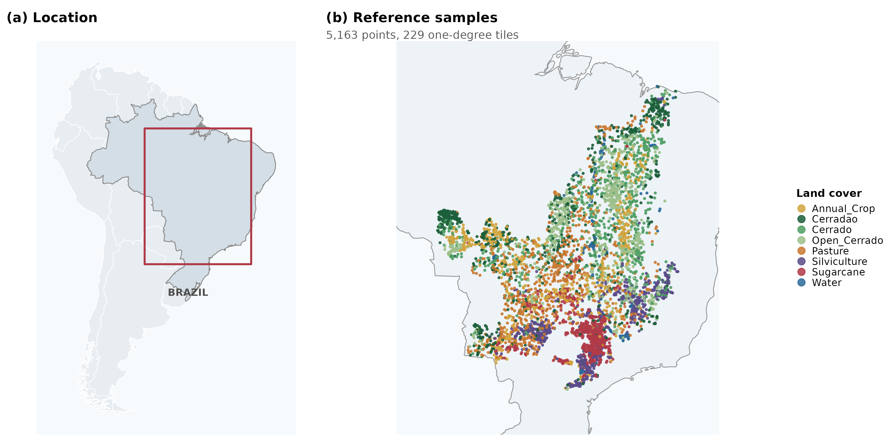

# svid 

**Systematic spectral index discovery, deduplication and validation in R.**

`svid` generates candidate spectral indices from a configurable grammar,
**collapses the pool to the features a learner can actually distinguish**,
screens them with fast separability statistics, and evaluates the survivors
under spatially aware resampling with confidence intervals, paired significance
tests and mandatory reference baselines.

## The problem it solves

Exhaustively generated index pools are far more redundant than they appear.
Two mechanisms are responsible:

* **Algebraic identity.** `(N/B)/R`, `(N/R)/B` and `N/(B*R)` are the same
  expression written three ways.
* **Monotone equivalence.** A random forest splits on rank order, so it cannot
  distinguish `N/R` from `R/N` or from `(N-R)/(N+R)`. For such a learner these
  are one feature, not three.

Rank a pool without collapsing these classes and the same feature occupies
several places in the table, with *different* accuracies — because the
differences come from floating-point representation and tie-breaking inside the
classifier, not from spectral information. In a four-band, depth-two pool the
reduction is typically 60–70%.

```r
library(svid)

d    <- svid_demo_data()
pool <- svid_generate(svid_grammar(c("B", "G", "R", "N"), max_depth = 2))
pool <- svid_prune(pool, d)          # generation -> canonical -> distinct -> classes
svid_redundancy(pool)
```

## Workflow

```r
data(andong)
d <- svid_from_table(andong,
                     bands = c(B = "B02", G = "B03", R = "B04", N = "B08"),
                     response = "class", id = "point_id", epoch = "date",
                     coords = c("x", "y"), group = "parcel",
                     sensor = "sentinel2")

pool <- svid_prune(svid_generate(svid_grammar(d$bands, max_depth = 2)), d)
sc   <- svid_separability(pool, d)                 # fast screen
fit  <- svid_evaluate(svid_shortlist(sc, 30), d,   # model the survivors
                      resampling = svid_resample(d, "group"),
                      baselines  = c("raw_bands", "catalog"))

svid_tied(fit)          # the group that cannot be separated from the best
svid_stability(fit, d)  # the noise floor of the ranking
svid_compare(fit)       # paired McNemar tests against NDVI
```

## Modules

| Module | Purpose | Key functions |
|---|---|---|
| Inputs | sensors, cubes, samples, extraction | `svid_sensor()` `svid_cube()` `svid_samples()` `svid_extract()` `svid_from_table()` |
| Generation | grammar and enumeration | `svid_grammar()` `svid_generate()` `svid_catalog()` `svid_eval()` `svid_temporal()` |
| Redundancy | the core reduction | `svid_canonicalize()` `svid_equivalence()` `svid_prune()` `svid_redundancy()` |
| Screening | cheap ranking | `svid_separability()` `svid_shortlist()` |
| Per-class | one index per class | `svid_per_class()` `svid_specialists()` `svid_ensemble()` |
| Evaluation | models and baselines | `svid_resample()` `svid_learner()` `svid_evaluate()` `svid_regress()` |
| Inference | ties, stability, optimism | `svid_ci()` `svid_compare()` `svid_tied()` `svid_stability()` `svid_optimism()` |
| Robustness | perturbation and transfer | `svid_perturb()` `svid_transfer()` `svid_cross_sensor()` `svid_prosail()` |
| Search | alternatives to enumeration | `svid_search()` `svid_beam()` `svid_pareto()` |
| Mapping | rasters and areas | `svid_map()` `svid_index_raster()` `svid_area()` `svid_disagree()` |
| Graphics | eleven plot functions | `svid_plot_redundancy()` `svid_plot_ranking()` `svid_plot_perclass()` … |

## Data

* `cerrado` — Landsat-8 surface reflectance at 5,163 points across the
  Brazilian Cerrado, 7 bands, 24 sixteen-day composites spanning the 2017–2018
  crop year, eight classes.
* `andong` — Sentinel-2A surface reflectance at 1,790 reference points, 32
  dates in 2022, three land-cover classes, tile T52SDF.
* `asi_indices` — 280 published indices from the Awesome Spectral Indices
  catalogue, for benchmarking.
* `svid_simulate()` — synthetic multispectral data on any sensor, including
  SWIR and red edge, for classification or regression.

## Installation

```r
# install.packages("remotes")
remotes::install_github("ehsanrahimi666/svid")
```

`terra`, `sf`, `ranger` and `ggplot2` are suggested rather than required: the
generation and redundancy modules run on base R alone.

## Citation

Rahimi, E. and Jung, C. (2026) svid: reproducible discovery, deduplication and
validation of spectral indices in R.

## Licence

GPL-3.

## Case study

The package ships the data behind the accompanying paper: 5,163 labelled points
across the Brazilian Cerrado, seven Landsat-8 bands, 24 sixteen-day composites
spanning the 2017–2018 crop year, eight land-cover classes.



```r
data(cerrado)
d <- svid_from_table(cerrado,
       bands = c(A = "SR_B1", B = "SR_B2", G = "SR_B3", R = "SR_B4",
                 N = "SR_B5", S1 = "SR_B6", S2 = "SR_B7"),
       response = "class", id = "point_id", epoch = "date",
       coords = c("longitude", "latitude"), group = "tile",
       sensor = "landsat8", scale = 1)

pool <- svid_prune(svid_generate(
          svid_grammar(c("B","G","R","N","S1","S2"), max_depth = 2, max_terms = 3)), d)
svid_redundancy(pool)      # 3,960 expressions -> 916 distinguishable features

pc <- svid_per_class(pool, d)        # one index per class
svid_specialists(pc)                 # what a single all-class index costs
svid_ensemble(pc, d, compare = c(NDVI = "(N - R) / (N + R)"))
```

Every class has a different best index, all eight use shortwave infrared, and
their most discriminating acquisitions are spread across the whole crop year.
